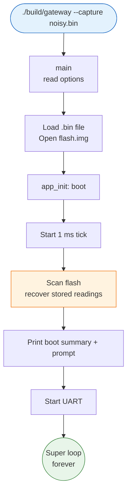
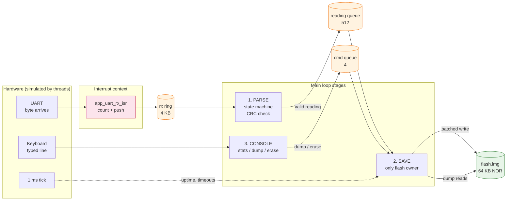
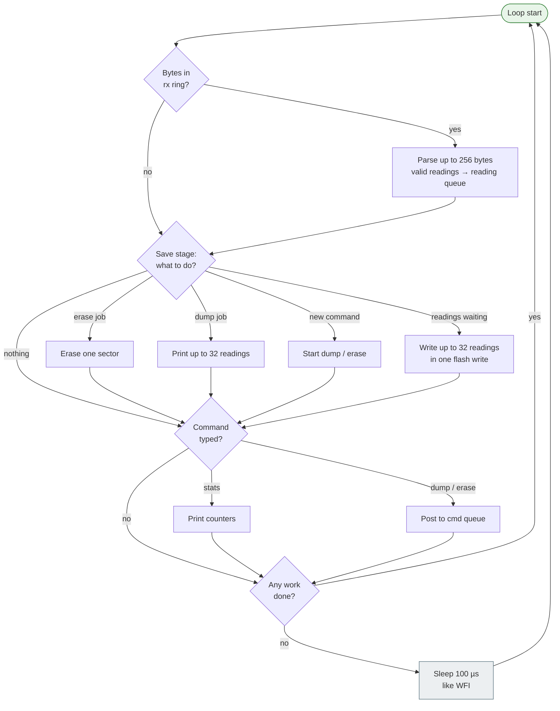
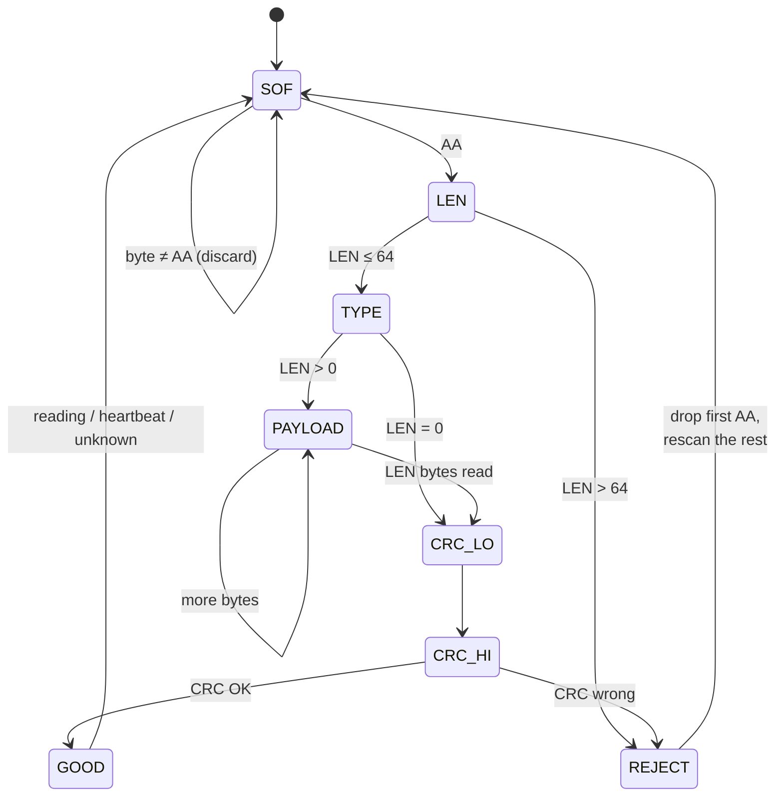
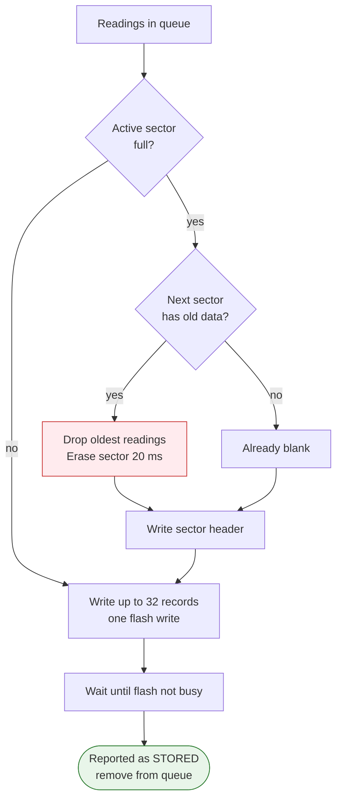
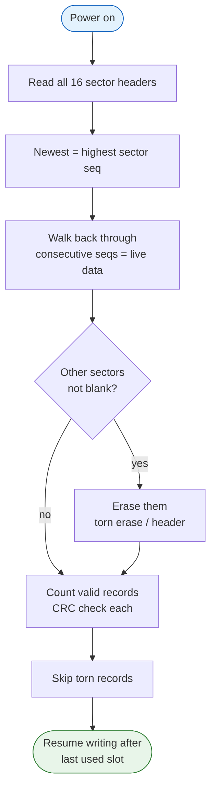

# How It Works: Visual Flow

## 1. Start-up

## 2. Data path: from UART byte to flash

## 3. One pass of the super loop

## 4. Parser: finding frames in noise

## 5. Saving a reading and power-cut safety

## 6. Boot after a power cut

